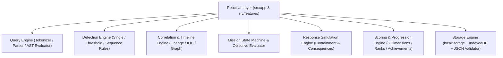

# CyberOps Simulator

> **Detect the signal. Investigate the evidence. Stop the threat.**

**CyberOps Simulator** is an interactive cybersecurity operations center (SOC) simulation game and defensive analyst training environment built with React, Vite, and a standalone JavaScript investigation engine.

> **Disclaimer:** CyberOps Simulator is an educational training simulator using 100% synthetic telemetry, reserved documentation IP ranges (`192.0.2.0/24`, `198.51.100.0/24`, `203.0.113.0/24`), and reserved example domains (`*.example.com`, `*.example.net`, `*.example.org`). It is **not** a production SIEM and is not a substitute for real enterprise incident response procedures.

---

## 1. Screenshots

> _Placeholder Note: The visual previews below are architectural placeholders until live production screenshots are captured._

- `[Screenshot Placeholder: Main Menu & Analyst Dossier (`/`) — Shows Analyst Rank, XP progress, Daily Challenge, Achievements, and the 8 Campaign Missions]`
- `[Screenshot Placeholder: SOC Command Center (`/soc`) — Displays Active Incident Alert Queue, Case Telemetry Severity Distribution, Sensor Status, and Mission Objectives]`
- `[Screenshot Placeholder: Investigation Workstation (`/mission/mission-3-suspicious-script/investigate`) — Multi-panel SIEM Event Explorer, Structured Query Bar, Evidence Locker, Entity Inspector, and Timeline]`
- `[Screenshot Placeholder: Post-Incident Debrief (`/mission/mission-3-suspicious-script/debrief`) — Grade S/A-F Evaluation, 6-Dimension Breakdown, Ground-Truth Walkthrough, and Printable Incident Report]`

---

## 2. Overview

In **CyberOps Simulator**, the player steps into the role of a SOC analyst at a fictional biotechnology organization (**Aegis BioLabs**). When suspicious telemetry triggers alerts across authentication, endpoint, DNS, firewall, file integrity, and web proxy feeds, the player must:

1. **Triage** the alert and review operational facts vs. unknowns in the Mission Briefing.
2. **Form a hypothesis** and query structured security events using a custom, safe query language.
3. **Collect evidence** into an Evidence Locker while avoiding unrelated noise.
4. **Correlate indicators** across multiple telemetry sources and inspect the chronological timeline.
5. **Run defensive detection rules** and evaluate MITRE ATT&CK v15 technique mappings and false-positive considerations.
6. **Execute proportionate simulated response actions** (isolating hosts, disabling compromised accounts, blocking C2 domains/IPs, preserving volatile evidence, or closing verified false positives).
7. **Submit a formal Incident Assessment Report** and receive a multi-dimensional debrief score, XP, rank promotions, and achievements.

---

## 3. Key Features

- **8 Complete, Deterministic Campaign Missions:** Progressing from a benign password rotation false positive (*The Noisy Login*) to multi-account password spraying, macro-spawned encoded PowerShell, DNS/HTTPS C2 beaconing, scheduled task persistence, privilege escalation, competing backup vs. exfiltration hypotheses, and a full kill-chain intrusion (*Multi-Stage Incident*).
- **Safe Recursive-Descent Structured Query Engine:** Supports `=`, `!=`, `>`, `<`, `>=`, `<=`, `CONTAINS`, `IN (...)`, `AND`, `OR`, `NOT`, and nested parentheses `(...)` without ever calling `eval` or `new Function`.
- **Real Detection Rule Engine:** 12 built-in defensive rules supporting single-event conditions, exclusion logic, sliding time-window threshold aggregations (`groupBy`, `windowSeconds`, `distinctField`), and multi-step sequences.
- **Chronological Timeline & Multi-Source Correlation:** Automatically computes relative time deltas (`Δ prev`, `Δ start`), builds an SVG entity relationship graph, and grades correlations as `CONFIRMED`, `PROBABLE`, or `WEAK` (explicitly warning that temporal proximity alone does not prove causality).
- **Consequence-Driven Response Simulation:** 10 simulated containment and disposition actions that dynamically update incident containment state and penalize premature containment (acting before collecting evidence) or disrupting benign production assets.
- **Anti-Lucky-Guess Scoring & Progression:** Evaluates 6 weighted dimensions, awards XP across 7 Analyst Ranks (*Trainee* to *Lead Analyst*), unlocks 9 Achievements, and prevents XP farming on mission replays.
- **Practice Lab, Daily Challenge, Endless Triage & Custom Scenario Import:** Includes a free-query sandbox, date-seeded daily challenge, seeded rapid alert triage drill, and schema-validated JSON scenario importer.

---

## 4. Gameplay Instructions

1. **Select a Mission:** Start with **Mission 1: The Noisy Login** from the Main Menu to learn the workflow.
2. **Read the Briefing:** Review the Initial Alert, Known Facts, Unknowns, and Consequences of Poor Decisions. Click **Begin Investigation**.
3. **Query & Filter Telemetry:** Use the Structured Query bar (or quick query chips and facet dropdowns) in the **Event Explorer** tab. Click any event row to inspect its fields in the right-hand **Event & Entity Inspector**.
4. **Pivot & Collect Evidence:** Click any highlighted entity badge (`host`, `username`, `sourceIp`, `destinationIp`, `domain`) in the Inspector to pivot your search, and click **+ Evidence** on records that prove or rule out malicious activity.
5. **Correlate & Run Detections:** Switch to **2. Timeline & Correlation** and **3. Detection Rules & ATT&CK** to verify process lineage, beacon intervals, and MITRE ATT&CK v15 mappings.
6. **Contain or Close:** Switch to **4. Response & Containment** and execute proportionate actions only after collecting supporting evidence.
7. **Submit Incident Report:** Complete **5. Incident Assessment & Debrief** to receive your grade, detailed coaching feedback, and printable/exportable report.

---

## 5. Technologies Used

- **Frontend UI:** React 18, JSX, modern CSS with custom variables and print stylesheet
- **Build Tool:** Vite 6
- **Icons:** Lucide React
- **Game Engine:** Pure modular JavaScript (`src/engine/*`) completely decoupled from React UI components
- **Persistence:** `localStorage` + `IndexedDB` (`CyberOpsSimulatorDB`) with schema-validated JSON import/export
- **Testing:** Vitest + React Testing Library + `jsdom`
- **Deployment:** Vercel (Static SPA with rewrite routing)

---

## 6. Architecture



See [docs/ARCHITECTURE.md](docs/ARCHITECTURE.md) and [docs/GAME_ENGINE.md](docs/GAME_ENGINE.md) for deep technical details.

---

## 7. Canonical Event Schema

Every synthetic telemetry event adheres to a strict canonical schema validated by `src/utils/eventSchema.js`:

| Field | Type | Required | Description |
| :--- | :--- | :--- | :--- |
| `eventId` | `string` | Yes | Unique stable event identifier (e.g. `EVT-305`) |
| `timestamp` | `string` | Yes | Timezone-aware ISO 8601 timestamp (`2026-10-20T13:22:18Z`) |
| `source` | `string` | Yes | Telemetry collector (`iam_auth`, `edr_sensor`, `dns_resolver`, `perimeter_fw`, `secure_proxy`, `file_integrity`, `directory_svc`) |
| `eventType` | `string` | Yes | Normalized category (`authentication`, `process_execution`, `dns_query`, `firewall_connection`, `web_proxy`, `file_activity`, `account_change`, `endpoint_detection`) |
| `severity` | `string` | Yes | `low`, `medium`, `high`, or `critical` |
| `message` | `string` | Yes | Human-readable summary of the telemetry record |
| `host` | `string` | Optional | Endpoint or server hostname (`WKSTN-FIN-04`) |
| `username` | `string` | Optional | Associated account identity (`m.chen`) |
| `sourceIp` | `string` | Optional | Origin IPv4 address |
| `destinationIp` | `string` | Optional | Destination IPv4 address |
| `domain` | `string` | Optional | Queried or requested domain (`staging.example.net`) |
| `processName` | `string` | Optional | Executing binary (`powershell.exe`) |
| `parentProcess` | `string` | Optional | Parent binary (`winword.exe`) |
| `commandLine` | `string` | Optional | Safe simulated command-line string |
| `action` / `result` | `string` | Optional | Operation and outcome (`user_login` / `failure`) |
| `tags` | `string[]` | Optional | Context tags (`["encoded_cmd", "suspicious_parent"]`) |
| `metadata` | `object` | Optional | Source-specific attributes and explicit `relatedEventIds` |

See [docs/EVENT_SCHEMA.md](docs/EVENT_SCHEMA.md) for full details.

---

## 8. Structured Query Language Reference

The built-in query engine (`src/engine/queryEngine.js`) supports:

- **Comparison Operators:** `=`, `!=`, `>`, `<`, `>=`, `<=`
- **Substring / Array Operator:** `CONTAINS` (case-insensitive)
- **Set Membership Operator:** `IN ("val1", "val2", ...)`
- **Logical Operators:** `AND`, `OR`, `NOT` and parentheses `(...)`

### Validated Example Queries
```text
eventType = "authentication"
username = "analyst.test" AND result = "failure"
sourceIp = "198.51.100.24" AND eventType = "authentication"
severity IN ("high", "critical")
processName CONTAINS "powershell"
(eventType = "dns_query" OR eventType = "web_proxy") AND NOT result = "blocked"
```

---

## 9. Detection Rule Format

Detection rules (`src/data/rules/detectionRules.js`) are declarative objects evaluated by `src/engine/detectionEngine.js`. Twelve rules (`DET-001` through `DET-012`) ship out of the box covering single-event conditions, exclusions, sliding time-window thresholds, and two-step event sequences. See [docs/DETECTION_RULES.md](docs/DETECTION_RULES.md).

---

## 10. Mission Campaign Catalogue

| # | Mission Title | Difficulty | Primary Focus & Telemetry | Ground-Truth Outcome |
| :- | :--- | :--- | :--- | :--- |
| **1** | **The Noisy Login** | Tutorial | Authentication triage, password rotation policy, FIDO2 MFA context | Benign Activity (`low`) |
| **2** | **Password Spray** | Easy | Multi-account aggregation, source IP correlation, legacy MFA bypass | Malicious Incident (`high`) |
| **3** | **The Suspicious Script** | Easy–Medium | Process trees (`winword.exe` vs `CcmExec.exe`), encoded PowerShell | Malicious Incident (`high`) |
| **4** | **The Strange Domain** | Medium | DNS resolution, IP pivoting, 60-second HTTPS POST C2 beaconing | Malicious Incident (`high`) |
| **5** | **Persistence** | Medium | Scheduled tasks (`schtasks`), registry Run keys, change ticket verification | Malicious Incident (`high`) |
| **6** | **The Compromised Account** | Medium–Hard | Session replay login, jump-host RDP, `Cloud Infra Admins` escalation, rogue user | Malicious Incident (`critical`) |
| **7** | **The Data Exfiltration Puzzle** | Hard | Competing hypotheses: 480 MB authorized DR backup vs 42 MB `7z.exe` M&A exfiltration | Malicious Incident (`critical`) |
| **8** | **Multi-Stage Incident** | Expert | Full intrusion kill chain across 7 sources with decoy noise and change tickets | Malicious Incident (`critical`) |

---

## 11. Scoring System, Ranks & Achievements

Every completed mission is scored across **6 weighted dimensions**:
- **Detection Accuracy (25%):** Classification, severity, and MITRE ATT&CK stage accuracy. Includes an **anti-lucky-guess safeguard** that caps detection score if the player guesses without collecting core evidence.
- **Evidence Quality (20%):** Core evidence coverage minus penalties for irrelevant noise events.
- **Investigation Completeness (20%):** Mission objectives completed and scoped entities documented.
- **Response Appropriateness (20%):** Proportionate containment actions minus penalties for premature containment (acting before collecting evidence) or disrupting benign assets.
- **Incident Report Quality (10%):** Completeness of key findings, scope, uncertainty, and follow-up recommendations.
- **Efficiency (5%):** Disciplined query usage and minimal hint reliance.

---

## 12. Local Setup & Testing Instructions

### Prerequisites
- Node.js 18+ and npm

### Installation & Development
```bash
npm install
npm run dev
```

### Running Unit, Integration & Regression Tests
```bash
npm test
```

### Building for Production
```bash
npm run build
npm run preview
```

---

## 13. Privacy & Security Model

- **100% Synthetic & Offline-Capable:** Uses reserved RFC 5737 documentation IPs (`192.0.2.0/24`, `198.51.100.0/24`, `203.0.113.0/24`) and RFC 2606 reserved domains (`*.example.com`, `*.example.net`, `*.example.org`).
- **No Code Execution:** The query engine uses a custom tokenizer, parser, and AST evaluator—never `eval()` or `new Function()`. Simulated command lines are rendered strictly as inert text.
- **Import Hardening:** Imported JSON saves and scenarios are size-bounded, schema-validated, and recursively stripped of `__proto__`, `constructor`, and `prototype` keys.
- **Zero External Telemetry:** No logs or player data are transmitted to external servers.

---

## 14. Known Limitations & Roadmap

### Known Limitations
- The query language supports structured boolean comparisons, `CONTAINS`, and `IN`, but does not implement pipe-based aggregation syntax (e.g., `| stats count by src_ip`)—aggregations are instead handled by the Detection Rule Engine and Entity Relationship Explorer.
- Sound cues use a lightweight Web Audio synthesizer (disabled by default) rather than bundled MP3 audio files to keep bundle size minimal.

### Recommended Future Improvements
1. **Pipe-Stage Aggregation Query Support:** Extend the query parser with `| stats count() by <field>` to allow ad-hoc bucketing directly in the search bar.
2. **Interactive Process Tree Visualizer:** Add a dedicated hierarchical process tree diagram view for endpoint telemetry missions.
3. **Multiplayer Co-Op SOC Shift Mode:** Allow two analysts to share an investigation workspace via WebRTC or WebSockets.

---

## 15. License

Released under the [MIT License](LICENSE).
