# Architecture Overview

## High-Level Design

CyberOps Simulator is architected as a **frontend-first, zero-backend single-page application (SPA)** where all simulation logic, query parsing, detection evaluation, event correlation, response state transitions, and scoring live in pure JavaScript modules (`src/engine/`) completely decoupled from the React presentation layer (`src/features/` and `src/components/`).

```mermaid
flowchart LR
  subgraph Data["Bundled Synthetic Data (src/data)"]
    Missions["8 Campaign Missions"]
    Rules["12 Detection Rules"]
    Extra["Daily / Endless / Custom Templates"]
    Glossary["SOC Field Glossary"]
  end

  subgraph Engine["Decoupled Game Engine (src/engine)"]
    QE["queryEngine.js"]
    DE["detectionEngine.js"]
    CE["correlationEngine.js"]
    SM["missionStateMachine.js"]
    RE["responseEngine.js"]
    SE["scoringEngine.js"]
    PE["progressionEngine.js"]
    ST["storageEngine.js"]
  end

  subgraph UI["React Workstation UI (src/features)"]
    Menu["MainMenuView"]
    SOC["SocCommandCenterView"]
    Brief["MissionBriefingView"]
    Work["InvestigationWorkstationView"]
    Debrief["MissionDebriefView"]
    Modes["ExtraModesView"]
  end

  Data --> Engine
  Engine --> UI
```

## Directory Layout

- `src/app/App.jsx` — Root application state coordinator, URL route synchronizer, and navigation shell.
- `src/components/` — Reusable UI primitives (`SeverityBadge.jsx`, `GlossaryModal.jsx`).
- `src/features/soc/` — Main Menu (`MainMenuView.jsx`) and SOC Command Center (`SocCommandCenterView.jsx`).
- `src/features/briefing/` — Operational Mission Briefing (`MissionBriefingView.jsx`).
- `src/features/investigation/` — Multi-panel SIEM Investigation Workstation (`InvestigationWorkstationView.jsx`).
- `src/features/reporting/` — Post-incident evaluation debrief and printable report (`MissionDebriefView.jsx`).
- `src/features/progression/` — Practice Lab, Endless Alert Triage, Custom Scenario Import, and Settings (`ExtraModesView.jsx`).
- `src/engine/` — Pure JavaScript engine modules testable without rendering React.
- `src/data/` — Bundled deterministic mission scenarios, detection rules, and glossary.
- `src/utils/` — Schema validators, prototype-pollution sanitizer, timestamp parsers, and optional Web Audio synthesizer.
- `tests/` — Unit, integration, and regression tests powered by Vitest and React Testing Library.
